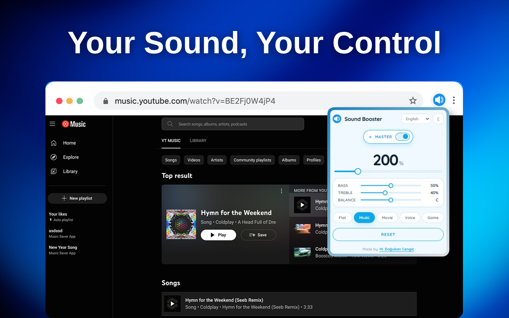
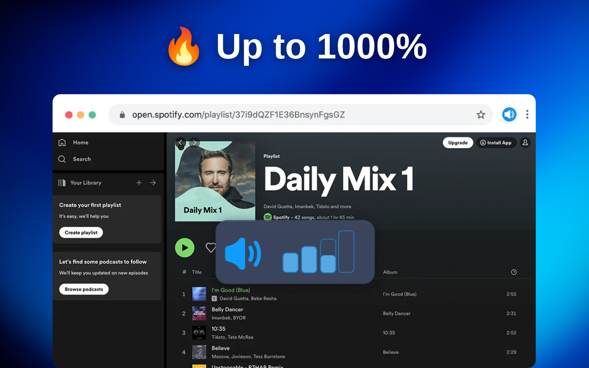
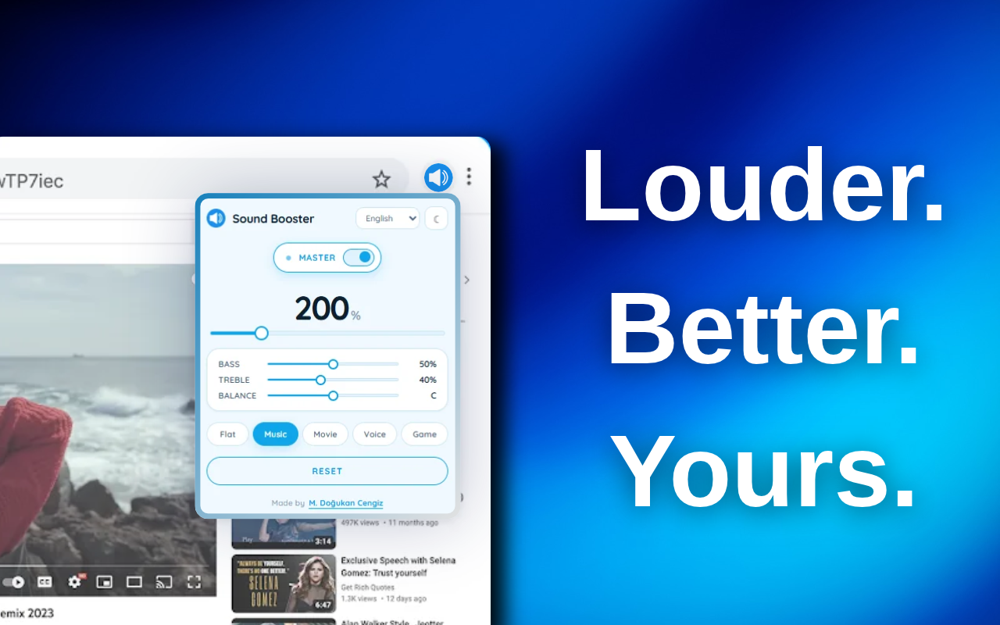

<h1 align="center">Sound Booster</h1>

<b>English</b> · <a href="docs/README.tr.md">Türkçe</a> · <a href="docs/README.es.md">Español</a> · <a href="docs/README.fr.md">Français</a> · <a href="docs/README.pt-BR.md">Português (BR)</a> · <a href="docs/README.ru.md">Русский</a> · <a href="docs/README.hi.md">हिन्दी</a> · <a href="docs/README.zh-CN.md">简体中文</a> · <a href="docs/README.ar.md">العربية</a>

   

       

Boost browser tab volume up to **1000%** — with bass, treble, balance and presets. Free and open source.

## Features

- 🔊 Volume boost up to **1000%** for any tab
- 🎚️ Bass, treble and left/right balance controls
- 🎛️ One-click presets: Flat, Music, Movie, Voice, Game
- 🛡️ Built-in limiter to reduce harsh clipping at high gain
- 🌗 Light and dark theme
- 🌍 9 interface languages: English, Türkçe, Español, Français, Português, Русский, हिन्दी, 中文, العربية
- 🎵 Shows the currently playing tab, with a quick reset button
- 🆓 No ads, no account, no tracking

## Screenshots

  

## Installation

### From the Chrome Web Store (recommended)

Install it in one click: **[Sound Booster on Chrome Web Store](https://chromewebstore.google.com/detail/ses-y%C3%BCkseltici/lglddafallgokgookachmcfafhkcobld)**.

### From source (developer mode)

1. Download or clone this repository.
2. Open `chrome://extensions` in Chrome (or any Chromium browser).
3. Turn on **Developer mode** (top right).
4. Click **Load unpacked** and select the `extension/` folder.

## Usage

Open the tab that plays audio, click the Sound Booster icon, switch **Master** on and drag the volume slider. Adjust bass, treble and balance, or pick a preset. Settings are kept per tab.

## Free template — use it however you like

Sound Booster is a **free template**. You can fork it, rebrand it, publish your own version and even reuse the **Chrome Web Store screenshots, images and logo** — free of charge, no permission needed. A link back to this project is appreciated but not required.

To make it yours: edit the name in `extension/_locales/*/messages.json`, the author link in `extension/popup.html` and `extension/popup.js`, and replace the icons.

## Support & Donate ❤️

This project is free and will stay free. If it helped you, you can support further development:

- [Support on Patreon](https://www.patreon.com/cw/dogukancengiz)
- [itch.io](https://dogukancengiz.itch.io/)

Starring ⭐ the repo, sharing it, or leaving a review on the Chrome Web Store also helps a lot!

## Privacy & permissions

Audio is processed locally in your browser with the Web Audio API. The extension does not collect, store or send any personal data and has no analytics. The popup loads the *Quicksand* font from Google Fonts.

**Why these permissions?**

- `tabCapture` – capture the audio of the current tab so it can be amplified
- `offscreen` – run the audio processing in an offscreen document (Manifest V3)
- `activeTab`, `tabs` – identify the current tab and show its title and icon
- `storage` – remember your settings
- `<all_urls>` – let the extension work on any website

## Links

- [Chrome Web Store](https://chromewebstore.google.com/detail/ses-y%C3%BCkseltici/lglddafallgokgookachmcfafhkcobld)
- [Website](https://www.dogukancengiz.com/)
- [GitHub](https://github.com/dogukan-cengiz)
- [X (Twitter)](https://x.com/mdogukancengiz)
- [Instagram](https://www.instagram.com/mdogukan.cengiz)
- [YouTube](https://www.youtube.com/@dogukan-cengiz)
- [Patreon](https://www.patreon.com/cw/dogukancengiz)
- [Reddit](https://www.reddit.com/user/dogukan_cengiz/)
- [Hugging Face](https://huggingface.co/dogukan-cengiz)
- [itch.io](https://dogukancengiz.itch.io/)

## License

Released under the [MIT License](LICENSE). © 2026 M. Doğukan Cengiz.
