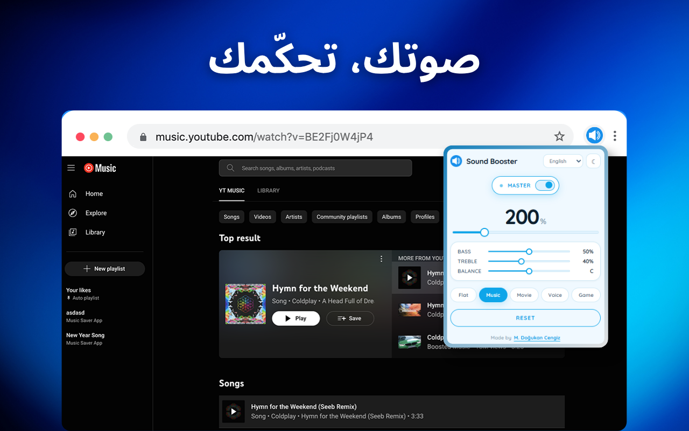
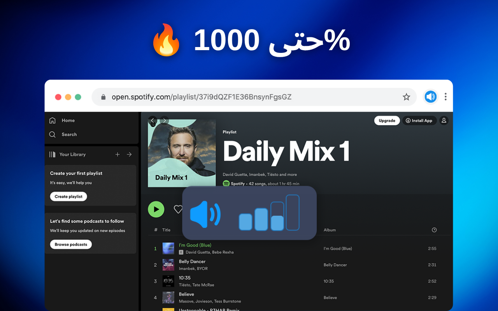
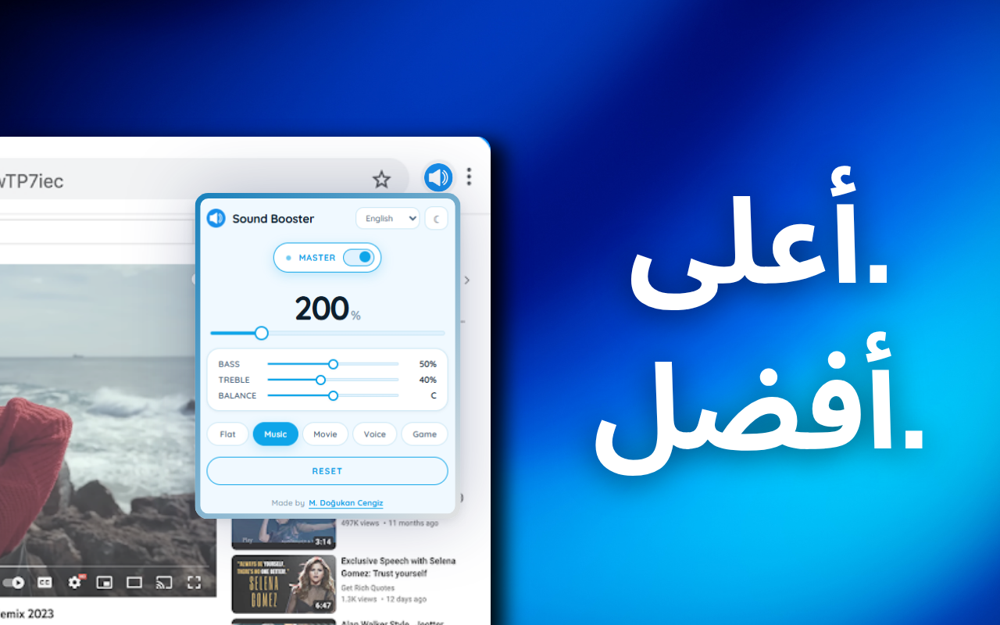

<h1 align="center">معزز الصوت (Sound Booster)</h1>

<a href="../README.md">English</a> · <a href="README.tr.md">Türkçe</a> · <a href="README.es.md">Español</a> · <a href="README.fr.md">Français</a> · <a href="README.pt-BR.md">Português (BR)</a> · <a href="README.ru.md">Русский</a> · <a href="README.hi.md">हिन्दी</a> · <a href="README.zh-CN.md">简体中文</a> · <b>العربية</b>

   

       

ارفع صوت علامات تبويب المتصفح حتى **1000%** — مع الباس والتريبل والتوازن والإعدادات المسبقة. مجاني ومفتوح المصدر.

## المميزات

- 🔊 رفع مستوى الصوت حتى **1000%** في أي علامة تبويب
- 🎚️ التحكم في الباس والتريبل والتوازن بين اليسار واليمين
- 🎛️ إعدادات مسبقة بنقرة واحدة: مسطح، موسيقى، فيلم، صوت، لعبة
- 🛡️ محدِّد مدمج لتقليل التشويه عند الكسب العالي
- 🌗 سمة فاتحة وداكنة
- 🌍 9 لغات للواجهة: English، Türkçe، Español، Français، Português، Русский، हिन्दी، 中文، العربية
- 🎵 يعرض علامة التبويب قيد التشغيل مع زر لإعادة التعيين
- 🆓 بدون إعلانات، بدون حساب، بدون تتبع

## لقطات الشاشة

  

## التثبيت

### من متجر Chrome الإلكتروني (موصى به)

ثبّته بنقرة واحدة: **[معزز الصوت في متجر Chrome الإلكتروني](https://chromewebstore.google.com/detail/ses-y%C3%BCkseltici/lglddafallgokgookachmcfafhkcobld)**.

### من الشيفرة المصدرية (وضع المطوّر)

1. حمّل هذا المستودع أو انسخه (clone).
2. افتح `chrome://extensions` في Chrome (أو أي متصفح يعتمد Chromium).
3. فعّل **وضع المطوّر** (أعلى اليمين).
4. انقر على **تحميل غير معبأ** واختر المجلد `extension/`.

## الاستخدام

افتح علامة التبويب التي تشغّل الصوت، وانقر على أيقونة Sound Booster، ثم فعّل **الرئيسي** واسحب شريط مستوى الصوت. اضبط الباس والتريبل والتوازن أو اختر إعدادًا مسبقًا. تُحفظ الإعدادات لكل علامة تبويب.

## قالب مجاني — استخدمه كما تشاء

Sound Booster **قالب مجاني**. يمكنك عمل Fork له وتغيير علامته التجارية ونشر نسختك الخاصة، بل وحتى إعادة استخدام **لقطات الشاشة والصور والشعار من متجر Chrome الإلكتروني** مجانًا ودون إذن. إضافة رابط لهذا المشروع أمر مُقدَّر لكنه غير إلزامي.

لتخصيصه: عدّل الاسم في `extension/_locales/*/messages.json` ورابط المطوّر في `extension/popup.html` و`extension/popup.js`، واستبدل الأيقونات.

## الدعم والتبرع ❤️

هذا المشروع مجاني وسيبقى كذلك. إذا أفادك، يمكنك دعم استمرار تطويره:

- [ادعم على Patreon](https://www.patreon.com/cw/dogukancengiz)
- [itch.io](https://dogukancengiz.itch.io/)

منح المستودع نجمة ⭐ أو مشاركته أو كتابة تقييم في متجر Chrome الإلكتروني يساعد كثيرًا أيضًا!

## الخصوصية والأذونات

تتم معالجة الصوت محليًا داخل متصفحك باستخدام Web Audio API. لا تجمع الإضافة أي بيانات شخصية ولا تخزنها ولا ترسلها، ولا تحتوي على تحليلات. تحمّل النافذة المنبثقة خط *Quicksand* من Google Fonts.

**لماذا هذه الأذونات؟**

- `tabCapture` – التقاط صوت علامة التبويب الحالية لتضخيمه
- `offscreen` – تشغيل معالجة الصوت في مستند خارج الشاشة (Manifest V3)
- `activeTab` و`tabs` – تحديد علامة التبويب الحالية وعرض عنوانها وأيقونتها
- `storage` – تذكّر إعداداتك
- `<all_urls>` – لتعمل الإضافة على أي موقع

## الروابط

- [Chrome Web Store](https://chromewebstore.google.com/detail/ses-y%C3%BCkseltici/lglddafallgokgookachmcfafhkcobld)
- [Website](https://www.dogukancengiz.com/)
- [GitHub](https://github.com/dogukan-cengiz)
- [X (Twitter)](https://x.com/mdogukancengiz)
- [Instagram](https://www.instagram.com/mdogukan.cengiz)
- [YouTube](https://www.youtube.com/@dogukan-cengiz)
- [Patreon](https://www.patreon.com/cw/dogukancengiz)
- [Reddit](https://www.reddit.com/user/dogukan_cengiz/)
- [Hugging Face](https://huggingface.co/dogukan-cengiz)
- [itch.io](https://dogukancengiz.itch.io/)

## الترخيص

مُصدَر بموجب [رخصة MIT](../LICENSE). © 2026 M. Doğukan Cengiz.

