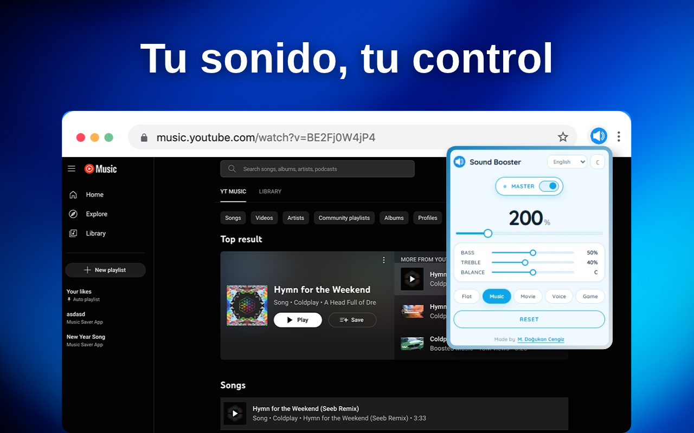
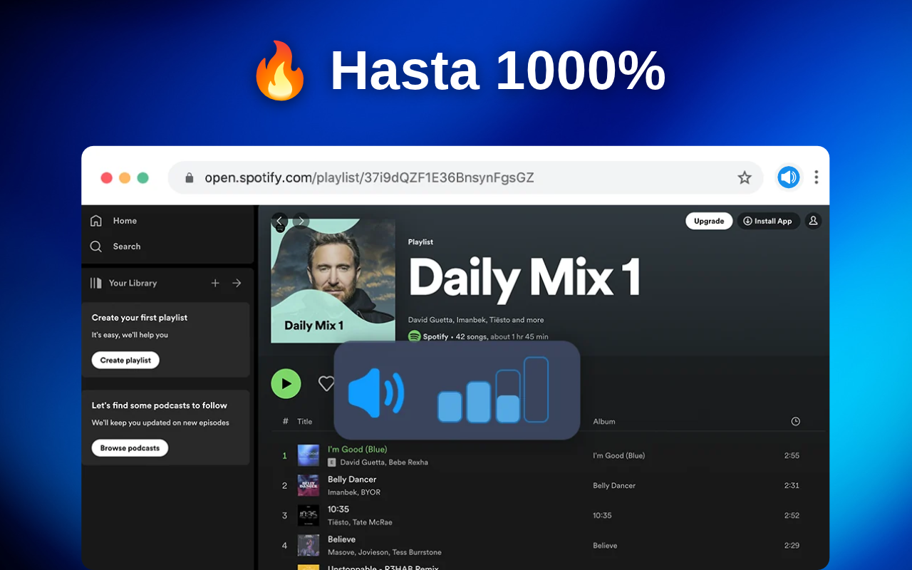
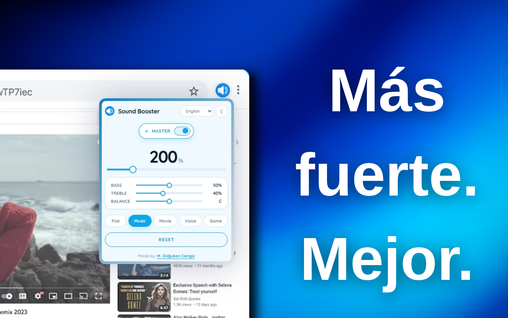

<h1 align="center">Amplificador de Sonido (Sound Booster)</h1>

<a href="../README.md">English</a> · <a href="README.tr.md">Türkçe</a> · <b>Español</b> · <a href="README.fr.md">Français</a> · <a href="README.pt-BR.md">Português (BR)</a> · <a href="README.ru.md">Русский</a> · <a href="README.hi.md">हिन्दी</a> · <a href="README.zh-CN.md">简体中文</a> · <a href="README.ar.md">العربية</a>

   

       

Sube el volumen de las pestañas del navegador hasta un **1000 %**, con graves, agudos, balance y preajustes. Gratis y de código abierto.

## Características

- 🔊 Aumento de volumen hasta **1000 %** en cualquier pestaña
- 🎚️ Control de graves, agudos y balance izquierdo/derecho
- 🎛️ Preajustes con un clic: Plano, Música, Película, Voz, Juego
- 🛡️ Limitador integrado para reducir la distorsión con ganancia alta
- 🌗 Tema claro y oscuro
- 🌍 9 idiomas de interfaz: English, Türkçe, Español, Français, Português, Русский, हिन्दी, 中文, العربية
- 🎵 Muestra la pestaña que se está reproduciendo y un botón de restablecer
- 🆓 Sin anuncios, sin cuenta, sin rastreo

## Capturas de pantalla

  

## Instalación

### Desde Chrome Web Store (recomendado)

Instálalo con un clic: **[Amplificador de Sonido en Chrome Web Store](https://chromewebstore.google.com/detail/ses-y%C3%BCkseltici/lglddafallgokgookachmcfafhkcobld)**.

### Desde el código fuente (modo desarrollador)

1. Descarga o clona este repositorio.
2. Abre `chrome://extensions` en Chrome (o en cualquier navegador Chromium).
3. Activa el **Modo de desarrollador** (arriba a la derecha).
4. Pulsa **Cargar descomprimida** y selecciona la carpeta `extension/`.

## Uso

Abre la pestaña que reproduce audio, pulsa el icono de Sound Booster, activa **Maestro** y arrastra el control de volumen. Ajusta graves, agudos y balance, o elige un preajuste. Los ajustes se guardan por pestaña.

## Plantilla gratuita: úsala como quieras

Sound Booster es una **plantilla gratuita**. Puedes hacer un fork, cambiarle la marca, publicar tu propia versión e incluso reutilizar las **capturas, imágenes y el logo de Chrome Web Store**, gratis y sin pedir permiso. Un enlace a este proyecto se agradece, pero no es obligatorio.

Para personalizarla: edita el nombre en `extension/_locales/*/messages.json`, el enlace del autor en `extension/popup.html` y `extension/popup.js`, y reemplaza los iconos.

## Apoyo y donaciones ❤️

Este proyecto es gratuito y seguirá siéndolo. Si te ha sido útil, puedes apoyar su desarrollo:

- [Apoyar en Patreon](https://www.patreon.com/cw/dogukancengiz)
- [itch.io](https://dogukancengiz.itch.io/)

¡Dar una estrella ⭐ al repositorio, compartirlo o dejar una reseña en Chrome Web Store también ayuda mucho!

## Privacidad y permisos

El audio se procesa localmente en tu navegador con la Web Audio API. La extensión no recopila, guarda ni envía datos personales y no incluye analíticas. La ventana emergente carga la fuente *Quicksand* desde Google Fonts.

**¿Por qué estos permisos?**

- `tabCapture` – captura el audio de la pestaña actual para amplificarlo
- `offscreen` – ejecuta el procesamiento de audio en un documento fuera de pantalla (Manifest V3)
- `activeTab`, `tabs` – identifican la pestaña actual y muestran su título e icono
- `storage` – recuerda tus ajustes
- `<all_urls>` – permite que funcione en cualquier sitio web

## Enlaces

- [Chrome Web Store](https://chromewebstore.google.com/detail/ses-y%C3%BCkseltici/lglddafallgokgookachmcfafhkcobld)
- [Website](https://www.dogukancengiz.com/)
- [GitHub](https://github.com/dogukan-cengiz)
- [X (Twitter)](https://x.com/mdogukancengiz)
- [Instagram](https://www.instagram.com/mdogukan.cengiz)
- [YouTube](https://www.youtube.com/@dogukan-cengiz)
- [Patreon](https://www.patreon.com/cw/dogukancengiz)
- [Reddit](https://www.reddit.com/user/dogukan_cengiz/)
- [Hugging Face](https://huggingface.co/dogukan-cengiz)
- [itch.io](https://dogukancengiz.itch.io/)

## Licencia

Publicado bajo la [Licencia MIT](../LICENSE). © 2026 M. Doğukan Cengiz.
