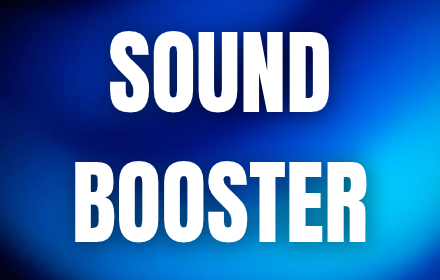
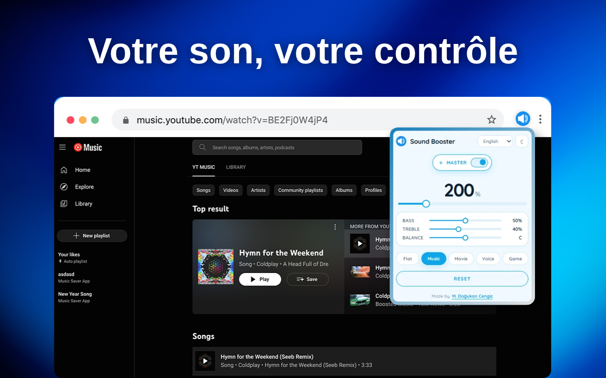
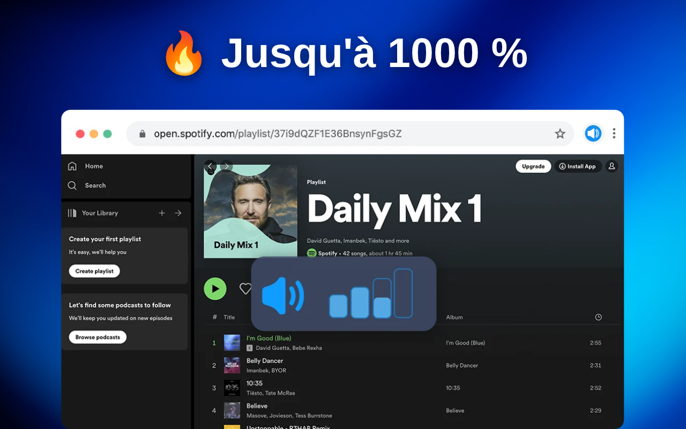
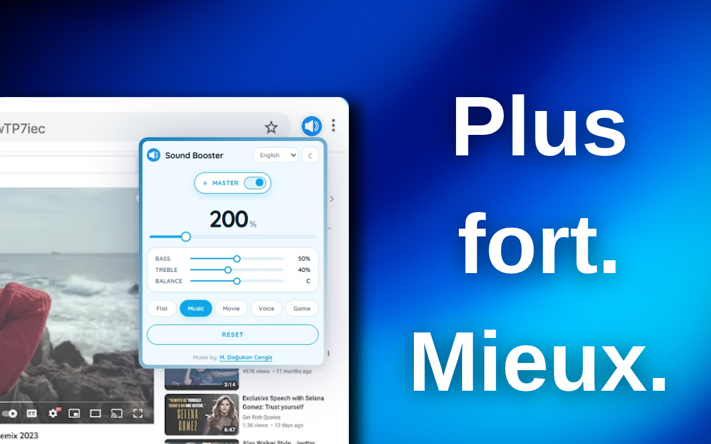

<h1 align="center">Amplificateur de Son (Sound Booster)</h1>

<a href="../README.md">English</a> · <a href="README.tr.md">Türkçe</a> · <a href="README.es.md">Español</a> · <b>Français</b> · <a href="README.pt-BR.md">Português (BR)</a> · <a href="README.ru.md">Русский</a> · <a href="README.hi.md">हिन्दी</a> · <a href="README.zh-CN.md">简体中文</a> · <a href="README.ar.md">العربية</a>

   

       

Augmentez le volume des onglets du navigateur jusqu'à **1000 %**, avec basses, aigus, balance et préréglages. Gratuit et open source.

## Fonctionnalités

- 🔊 Amplification du volume jusqu'à **1000 %** sur n'importe quel onglet
- 🎚️ Réglage des basses, des aigus et de la balance gauche/droite
- 🎛️ Préréglages en un clic : Neutre, Musique, Film, Voix, Jeu
- 🛡️ Limiteur intégré pour réduire la saturation à fort gain
- 🌗 Thème clair et sombre
- 🌍 9 langues d'interface : English, Türkçe, Español, Français, Português, Русский, हिन्दी, 中文, العربية
- 🎵 Affiche l'onglet en cours de lecture, avec un bouton de réinitialisation
- 🆓 Sans publicité, sans compte, sans pistage

## Captures d'écran

  

## Installation

### Depuis le Chrome Web Store (recommandé)

Installez-le en un clic : **[Amplificateur de Son sur le Chrome Web Store](https://chromewebstore.google.com/detail/ses-y%C3%BCkseltici/lglddafallgokgookachmcfafhkcobld)**.

### Depuis les sources (mode développeur)

1. Téléchargez ou clonez ce dépôt.
2. Ouvrez `chrome://extensions` dans Chrome (ou un autre navigateur Chromium).
3. Activez le **Mode développeur** (en haut à droite).
4. Cliquez sur **Charger l'extension non empaquetée** et choisissez le dossier `extension/`.

## Utilisation

Ouvrez l'onglet qui diffuse du son, cliquez sur l'icône Sound Booster, activez **Maître** et faites glisser le curseur de volume. Réglez les basses, les aigus et la balance, ou choisissez un préréglage. Les réglages sont conservés par onglet.

## Modèle gratuit : utilisez-le comme vous voulez

Sound Booster est un **modèle gratuit**. Vous pouvez le forker, changer sa marque, publier votre propre version et même réutiliser les **captures d'écran, images et le logo du Chrome Web Store**, gratuitement et sans demander d'autorisation. Un lien vers ce projet est apprécié mais pas obligatoire.

Pour le personnaliser : modifiez le nom dans `extension/_locales/*/messages.json`, le lien de l'auteur dans `extension/popup.html` et `extension/popup.js`, et remplacez les icônes.

## Soutien et dons ❤️

Ce projet est gratuit et le restera. S'il vous a été utile, vous pouvez soutenir son développement :

- [Soutenir sur Patreon](https://www.patreon.com/cw/dogukancengiz)
- [itch.io](https://dogukancengiz.itch.io/)

Mettre une étoile ⭐ au dépôt, le partager ou laisser un avis sur le Chrome Web Store aide aussi beaucoup !

## Confidentialité et autorisations

L'audio est traité localement dans votre navigateur avec la Web Audio API. L'extension ne collecte, ne stocke et n'envoie aucune donnée personnelle et n'inclut aucune analyse. La fenêtre contextuelle charge la police *Quicksand* depuis Google Fonts.

**Pourquoi ces autorisations ?**

- `tabCapture` – capture le son de l'onglet actuel pour l'amplifier
- `offscreen` – exécute le traitement audio dans un document hors écran (Manifest V3)
- `activeTab`, `tabs` – identifient l'onglet actuel et affichent son titre et son icône
- `storage` – mémorise vos réglages
- `<all_urls>` – permet à l'extension de fonctionner sur tous les sites

## Liens

- [Chrome Web Store](https://chromewebstore.google.com/detail/ses-y%C3%BCkseltici/lglddafallgokgookachmcfafhkcobld)
- [Website](https://www.dogukancengiz.com/)
- [GitHub](https://github.com/dogukan-cengiz)
- [X (Twitter)](https://x.com/mdogukancengiz)
- [Instagram](https://www.instagram.com/mdogukan.cengiz)
- [YouTube](https://www.youtube.com/@dogukan-cengiz)
- [Patreon](https://www.patreon.com/cw/dogukancengiz)
- [Reddit](https://www.reddit.com/user/dogukan_cengiz/)
- [Hugging Face](https://huggingface.co/dogukan-cengiz)
- [itch.io](https://dogukancengiz.itch.io/)

## Licence

Publié sous [licence MIT](../LICENSE). © 2026 M. Doğukan Cengiz.
