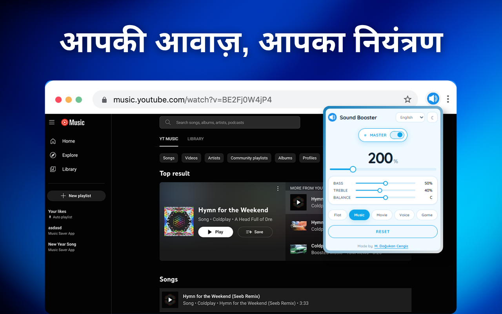
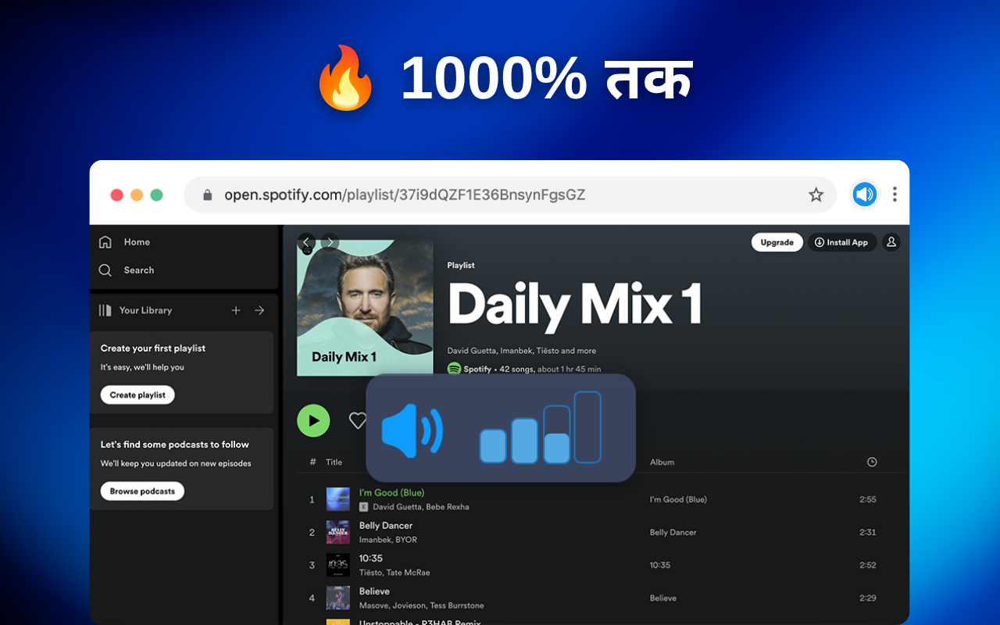
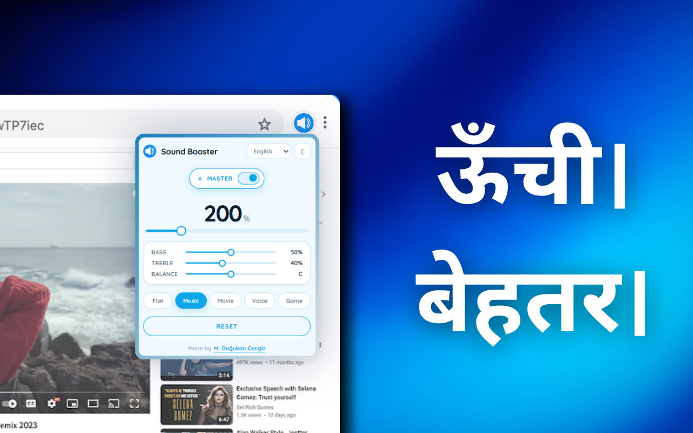

<h1 align="center">ध्वनि बूस्टर (Sound Booster)</h1>

<a href="../README.md">English</a> · <a href="README.tr.md">Türkçe</a> · <a href="README.es.md">Español</a> · <a href="README.fr.md">Français</a> · <a href="README.pt-BR.md">Português (BR)</a> · <a href="README.ru.md">Русский</a> · <b>हिन्दी</b> · <a href="README.zh-CN.md">简体中文</a> · <a href="README.ar.md">العربية</a>

   

       

ब्राउज़र टैब की आवाज़ **1000%** तक बढ़ाएँ — बास, ट्रेबल, बैलेंस और प्रीसेट के साथ। मुफ़्त और ओपन सोर्स।

## विशेषताएँ

- 🔊 किसी भी टैब में **1000%** तक वॉल्यूम बूस्ट
- 🎚️ बास, ट्रेबल और बाएँ/दाएँ बैलेंस नियंत्रण
- 🎛️ एक क्लिक में प्रीसेट: सामान्य, संगीत, फ़िल्म, आवाज़, गेम
- 🛡️ ऊँचे गेन पर विकृति घटाने के लिए इन-बिल्ट लिमिटर
- 🌗 लाइट और डार्क थीम
- 🌍 9 इंटरफ़ेस भाषाएँ: English, Türkçe, Español, Français, Português, Русский, हिन्दी, 中文, العربية
- 🎵 चल रहा टैब दिखाता है, साथ में रीसेट बटन
- 🆓 कोई विज्ञापन नहीं, कोई अकाउंट नहीं, कोई ट्रैकिंग नहीं

## स्क्रीनशॉट

  

## इंस्टॉलेशन

### Chrome Web Store से (अनुशंसित)

एक क्लिक में इंस्टॉल करें: **[Chrome Web Store पर ध्वनि बूस्टर](https://chromewebstore.google.com/detail/ses-y%C3%BCkseltici/lglddafallgokgookachmcfafhkcobld)**।

### सोर्स से (डेवलपर मोड)

1. इस रिपॉज़िटरी को डाउनलोड या क्लोन करें।
2. Chrome (या किसी भी Chromium ब्राउज़र) में `chrome://extensions` खोलें।
3. ऊपर दाईं ओर **Developer mode** चालू करें।
4. **Load unpacked** पर क्लिक करें और `extension/` फ़ोल्डर चुनें।

## उपयोग

जिस टैब में ऑडियो चल रहा है उसे खोलें, Sound Booster आइकन पर क्लिक करें, **मुख्य** को चालू करें और वॉल्यूम स्लाइडर खींचें। बास, ट्रेबल और बैलेंस समायोजित करें या कोई प्रीसेट चुनें। सेटिंग्स प्रति टैब सहेजी जाती हैं।

## मुफ़्त टेम्पलेट — जैसे चाहें इस्तेमाल करें

Sound Booster एक **मुफ़्त टेम्पलेट** है। आप इसे फ़ोर्क कर सकते हैं, अपने नाम से बदल सकते हैं, अपना संस्करण प्रकाशित कर सकते हैं और **Chrome Web Store के स्क्रीनशॉट, चित्र और लोगो** भी बिना शुल्क और बिना अनुमति के इस्तेमाल कर सकते हैं। इस प्रोजेक्ट का लिंक देना अच्छा रहेगा, पर ज़रूरी नहीं है।

अपना बनाने के लिए: `extension/_locales/*/messages.json` में नाम, `extension/popup.html` और `extension/popup.js` में निर्माता का लिंक बदलें और आइकन बदल दें।

## सहयोग और दान ❤️

यह प्रोजेक्ट मुफ़्त है और मुफ़्त ही रहेगा। अगर इससे आपको मदद मिली, तो आप आगे के विकास में सहयोग कर सकते हैं:

- [Patreon पर सहयोग करें](https://www.patreon.com/cw/dogukancengiz)
- [itch.io](https://dogukancengiz.itch.io/)

रिपॉज़िटरी को स्टार ⭐ देना, शेयर करना या Chrome Web Store पर रिव्यू लिखना भी बहुत मदद करता है!

## गोपनीयता और अनुमतियाँ

ऑडियो आपके ब्राउज़र में Web Audio API से स्थानीय रूप से प्रोसेस होता है। एक्सटेंशन कोई व्यक्तिगत डेटा एकत्र, संग्रहीत या भेजता नहीं है और इसमें कोई एनालिटिक्स नहीं है। पॉपअप Google Fonts से *Quicksand* फ़ॉन्ट लोड करता है।

**ये अनुमतियाँ क्यों?**

- `tabCapture` – वर्तमान टैब की आवाज़ को कैप्चर कर उसे बढ़ाने के लिए
- `offscreen` – ऑडियो प्रोसेसिंग को ऑफ़स्क्रीन दस्तावेज़ में चलाने के लिए (Manifest V3)
- `activeTab`, `tabs` – वर्तमान टैब पहचानने और उसका शीर्षक व आइकन दिखाने के लिए
- `storage` – आपकी सेटिंग्स याद रखने के लिए
- `<all_urls>` – किसी भी वेबसाइट पर काम करने के लिए

## लिंक

- [Chrome Web Store](https://chromewebstore.google.com/detail/ses-y%C3%BCkseltici/lglddafallgokgookachmcfafhkcobld)
- [Website](https://www.dogukancengiz.com/)
- [GitHub](https://github.com/dogukan-cengiz)
- [X (Twitter)](https://x.com/mdogukancengiz)
- [Instagram](https://www.instagram.com/mdogukan.cengiz)
- [YouTube](https://www.youtube.com/@dogukan-cengiz)
- [Patreon](https://www.patreon.com/cw/dogukancengiz)
- [Reddit](https://www.reddit.com/user/dogukan_cengiz/)
- [Hugging Face](https://huggingface.co/dogukan-cengiz)
- [itch.io](https://dogukancengiz.itch.io/)

## लाइसेंस

[MIT लाइसेंस](../LICENSE) के तहत जारी। © 2026 M. Doğukan Cengiz।
