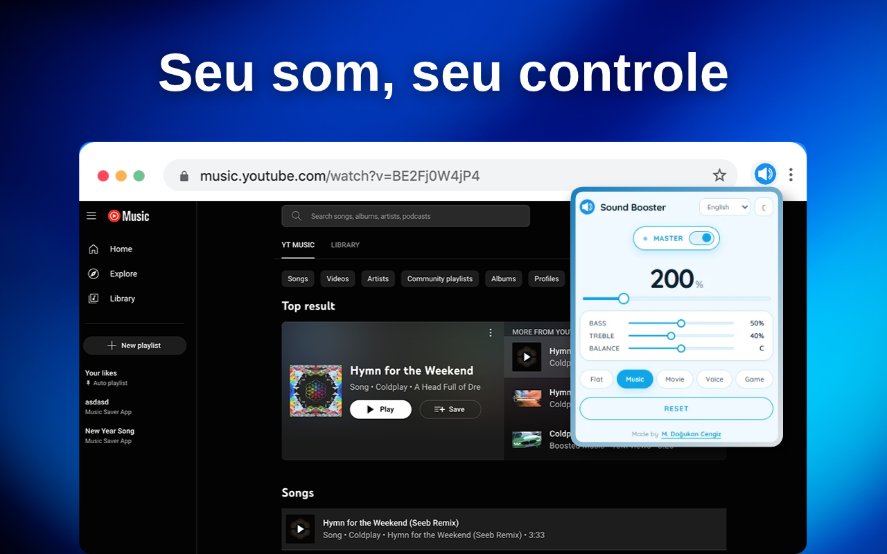
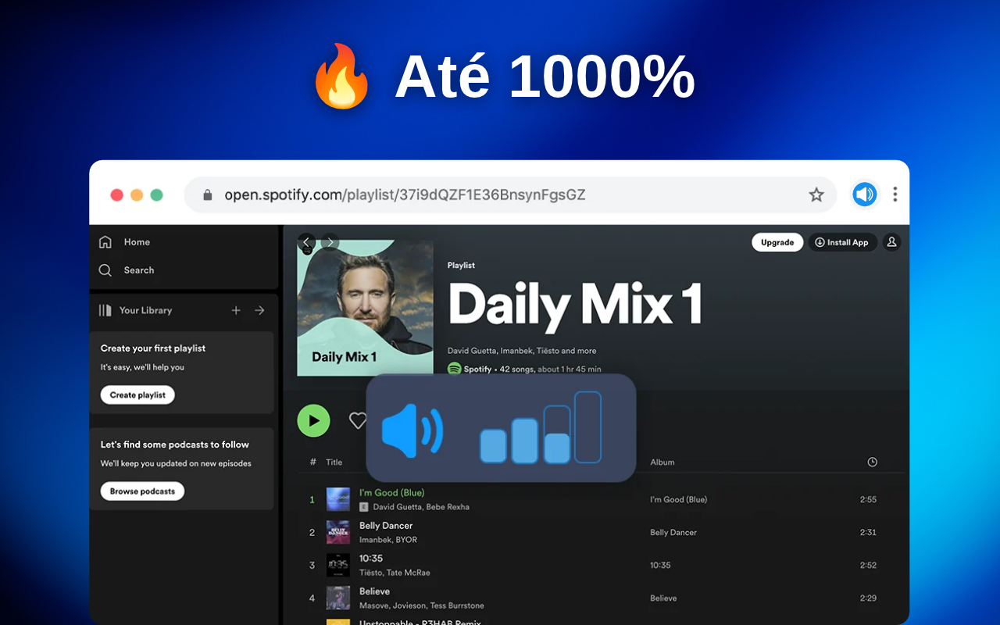
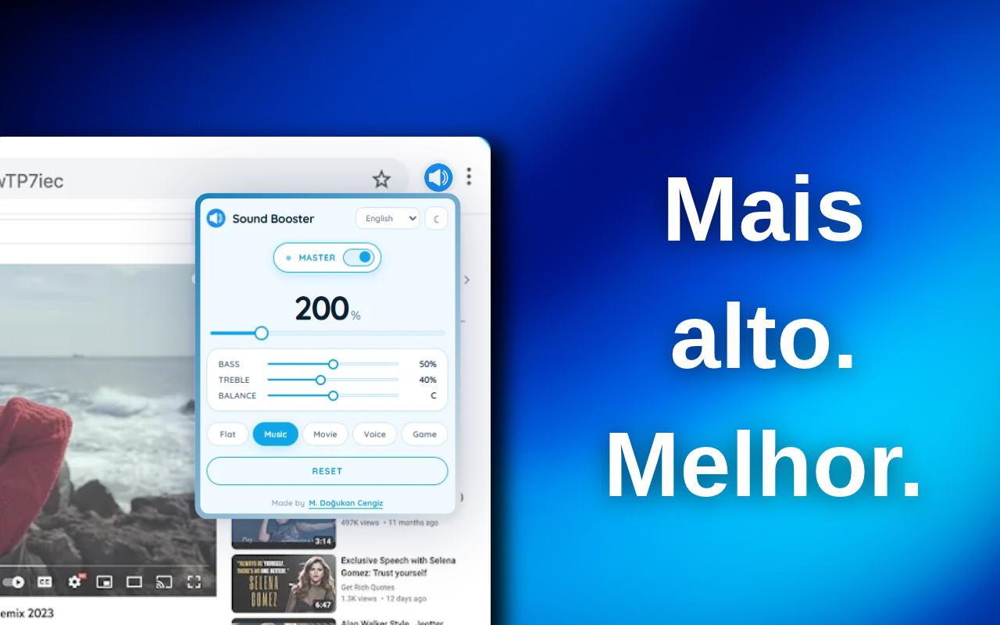

<h1 align="center">Amplificador de Som (Sound Booster)</h1>

<a href="../README.md">English</a> · <a href="README.tr.md">Türkçe</a> · <a href="README.es.md">Español</a> · <a href="README.fr.md">Français</a> · <b>Português (BR)</b> · <a href="README.ru.md">Русский</a> · <a href="README.hi.md">हिन्दी</a> · <a href="README.zh-CN.md">简体中文</a> · <a href="README.ar.md">العربية</a>

   

       

Aumente o volume das abas do navegador em até **1000%**, com graves, agudos, balanço e predefinições. Gratuito e de código aberto.

## Recursos

- 🔊 Aumento de volume de até **1000%** em qualquer aba
- 🎚️ Controles de graves, agudos e balanço esquerda/direita
- 🎛️ Predefinições com um clique: Plano, Música, Filme, Voz, Jogo
- 🛡️ Limitador integrado para reduzir distorção em ganho alto
- 🌗 Tema claro e escuro
- 🌍 9 idiomas de interface: English, Türkçe, Español, Français, Português, Русский, हिन्दी, 中文, العربية
- 🎵 Mostra a aba em reprodução, com botão de redefinir
- 🆓 Sem anúncios, sem conta, sem rastreamento

## Capturas de tela

  

## Instalação

### Pela Chrome Web Store (recomendado)

Instale com um clique: **[Amplificador de Som na Chrome Web Store](https://chromewebstore.google.com/detail/ses-y%C3%BCkseltici/lglddafallgokgookachmcfafhkcobld)**.

### A partir do código-fonte (modo desenvolvedor)

1. Baixe ou clone este repositório.
2. Abra `chrome://extensions` no Chrome (ou em qualquer navegador Chromium).
3. Ative o **Modo do desenvolvedor** (canto superior direito).
4. Clique em **Carregar sem compactação** e selecione a pasta `extension/`.

## Como usar

Abra a aba que reproduz áudio, clique no ícone do Sound Booster, ative **Mestre** e arraste o controle de volume. Ajuste graves, agudos e balanço, ou escolha uma predefinição. As configurações são mantidas por aba.

## Template gratuito: use como quiser

O Sound Booster é um **template gratuito**. Você pode fazer um fork, trocar a marca, publicar sua própria versão e até reutilizar as **capturas de tela, imagens e o logo da Chrome Web Store**, de graça e sem pedir permissão. Um link para este projeto é bem-vindo, mas não obrigatório.

Para personalizar: edite o nome em `extension/_locales/*/messages.json`, o link do autor em `extension/popup.html` e `extension/popup.js`, e troque os ícones.

## Apoio e doações ❤️

Este projeto é gratuito e continuará sendo. Se ele ajudou você, apoie o desenvolvimento:

- [Apoiar no Patreon](https://www.patreon.com/cw/dogukancengiz)
- [itch.io](https://dogukancengiz.itch.io/)

Dar uma estrela ⭐ no repositório, compartilhar ou deixar uma avaliação na Chrome Web Store também ajuda muito!

## Privacidade e permissões

O áudio é processado localmente no seu navegador com a Web Audio API. A extensão não coleta, armazena nem envia dados pessoais e não possui análises. O popup carrega a fonte *Quicksand* do Google Fonts.

**Por que essas permissões?**

- `tabCapture` – captura o áudio da aba atual para amplificá-lo
- `offscreen` – executa o processamento de áudio em um documento fora da tela (Manifest V3)
- `activeTab`, `tabs` – identificam a aba atual e mostram seu título e ícone
- `storage` – lembra suas configurações
- `<all_urls>` – permite que funcione em qualquer site

## Links

- [Chrome Web Store](https://chromewebstore.google.com/detail/ses-y%C3%BCkseltici/lglddafallgokgookachmcfafhkcobld)
- [Website](https://www.dogukancengiz.com/)
- [GitHub](https://github.com/dogukan-cengiz)
- [X (Twitter)](https://x.com/mdogukancengiz)
- [Instagram](https://www.instagram.com/mdogukan.cengiz)
- [YouTube](https://www.youtube.com/@dogukan-cengiz)
- [Patreon](https://www.patreon.com/cw/dogukancengiz)
- [Reddit](https://www.reddit.com/user/dogukan_cengiz/)
- [Hugging Face](https://huggingface.co/dogukan-cengiz)
- [itch.io](https://dogukancengiz.itch.io/)

## Licença

Publicado sob a [Licença MIT](../LICENSE). © 2026 M. Doğukan Cengiz.
