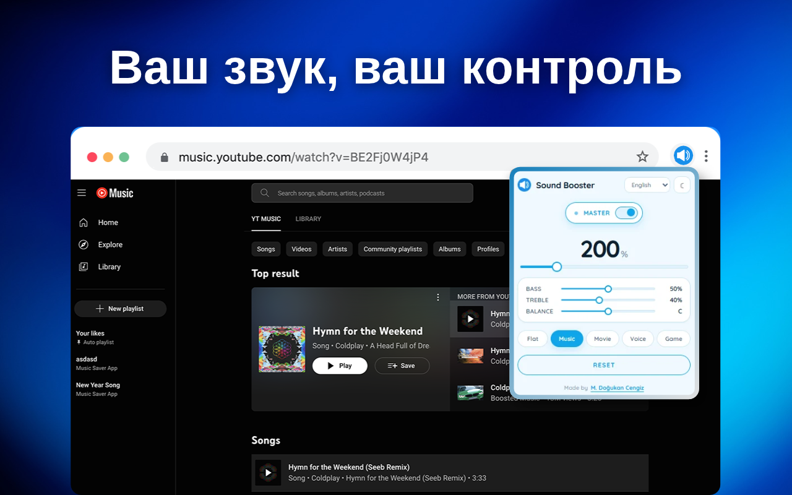
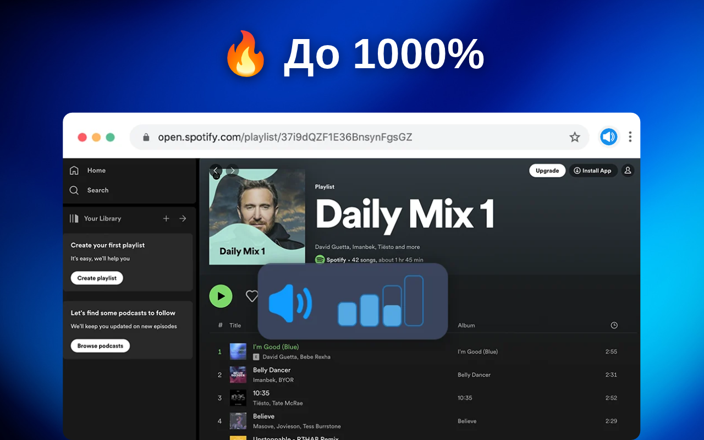
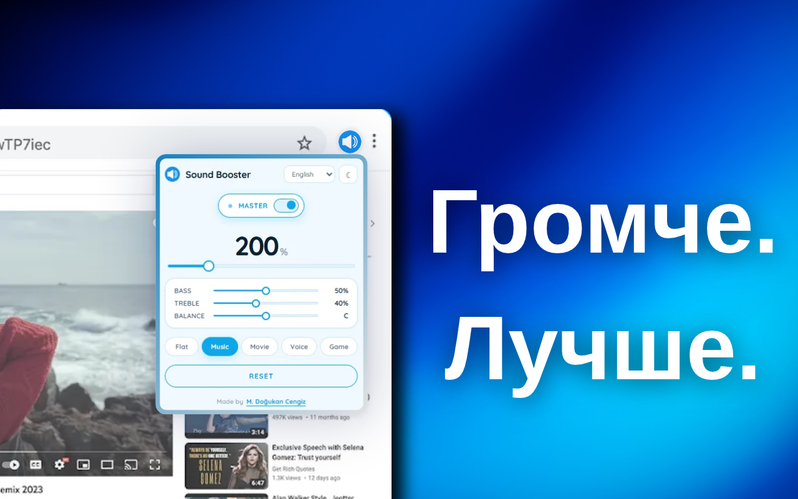

<h1 align="center">Усилитель Звука (Sound Booster)</h1>

<a href="../README.md">English</a> · <a href="README.tr.md">Türkçe</a> · <a href="README.es.md">Español</a> · <a href="README.fr.md">Français</a> · <a href="README.pt-BR.md">Português (BR)</a> · <b>Русский</b> · <a href="README.hi.md">हिन्दी</a> · <a href="README.zh-CN.md">简体中文</a> · <a href="README.ar.md">العربية</a>

   

       

Увеличивайте громкость вкладок браузера до **1000%** — с басами, высокими, балансом и пресетами. Бесплатно и с открытым исходным кодом.

## Возможности

- 🔊 Усиление громкости до **1000%** на любой вкладке
- 🎚️ Регулировка басов, высоких частот и баланса лево/право
- 🎛️ Пресеты в один клик: Плоский, Музыка, Фильм, Голос, Игра
- 🛡️ Встроенный лимитер снижает искажения при сильном усилении
- 🌗 Светлая и тёмная темы
- 🌍 9 языков интерфейса: English, Türkçe, Español, Français, Português, Русский, हिन्दी, 中文, العربية
- 🎵 Показывает воспроизводимую вкладку и кнопку сброса
- 🆓 Без рекламы, без аккаунта, без слежки

## Скриншоты

  

## Установка

### Из Chrome Web Store (рекомендуется)

Установите в один клик: **[Усилитель Звука в Chrome Web Store](https://chromewebstore.google.com/detail/ses-y%C3%BCkseltici/lglddafallgokgookachmcfafhkcobld)**.

### Из исходников (режим разработчика)

1. Скачайте или клонируйте этот репозиторий.
2. Откройте `chrome://extensions` в Chrome (или другом Chromium-браузере).
3. Включите **Режим разработчика** (справа вверху).
4. Нажмите **Загрузить распакованное расширение** и выберите папку `extension/`.

## Использование

Откройте вкладку со звуком, нажмите на значок Sound Booster, включите **Мастер** и перетащите ползунок громкости. Настройте басы, высокие и баланс или выберите пресет. Настройки сохраняются для каждой вкладки.

## Бесплатный шаблон — используйте как угодно

Sound Booster — **бесплатный шаблон**. Вы можете сделать форк, сменить бренд, опубликовать свою версию и даже использовать **скриншоты, изображения и логотип из Chrome Web Store** — бесплатно и без разрешения. Ссылка на этот проект приветствуется, но не обязательна.

Чтобы адаптировать под себя: измените название в `extension/_locales/*/messages.json`, ссылку на автора в `extension/popup.html` и `extension/popup.js`, и замените иконки.

## Поддержка и пожертвования ❤️

Проект бесплатный и таким останется. Если он вам помог, вы можете поддержать разработку:

- [Поддержать на Patreon](https://www.patreon.com/cw/dogukancengiz)
- [itch.io](https://dogukancengiz.itch.io/)

Звезда ⭐ репозиторию, репост или отзыв в Chrome Web Store тоже очень помогают!

## Конфиденциальность и разрешения

Звук обрабатывается локально в вашем браузере через Web Audio API. Расширение не собирает, не хранит и не отправляет личные данные и не использует аналитику. Всплывающее окно загружает шрифт *Quicksand* из Google Fonts.

**Зачем нужны разрешения?**

- `tabCapture` — захват звука текущей вкладки для усиления
- `offscreen` — обработка звука во внеэкранном документе (Manifest V3)
- `activeTab`, `tabs` — определение текущей вкладки, показ её названия и значка
- `storage` — сохранение настроек
- `<all_urls>` — работа на любых сайтах

## Ссылки

- [Chrome Web Store](https://chromewebstore.google.com/detail/ses-y%C3%BCkseltici/lglddafallgokgookachmcfafhkcobld)
- [Website](https://www.dogukancengiz.com/)
- [GitHub](https://github.com/dogukan-cengiz)
- [X (Twitter)](https://x.com/mdogukancengiz)
- [Instagram](https://www.instagram.com/mdogukan.cengiz)
- [YouTube](https://www.youtube.com/@dogukan-cengiz)
- [Patreon](https://www.patreon.com/cw/dogukancengiz)
- [Reddit](https://www.reddit.com/user/dogukan_cengiz/)
- [Hugging Face](https://huggingface.co/dogukan-cengiz)
- [itch.io](https://dogukancengiz.itch.io/)

## Лицензия

Распространяется по [лицензии MIT](../LICENSE). © 2026 M. Doğukan Cengiz.
