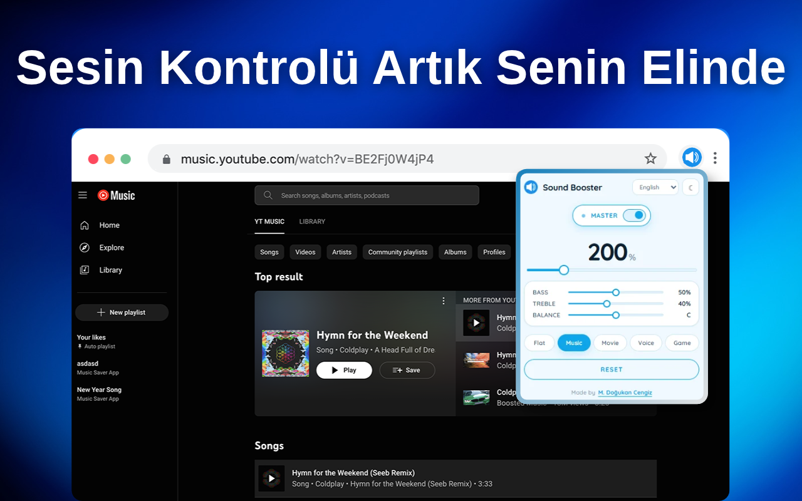
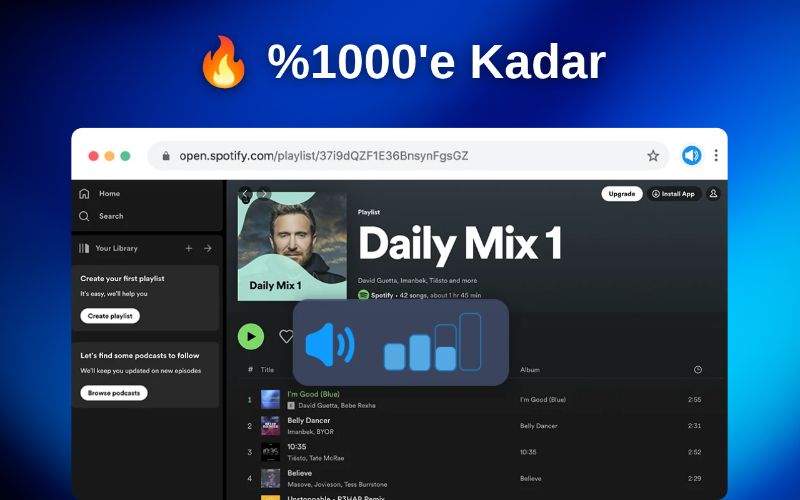
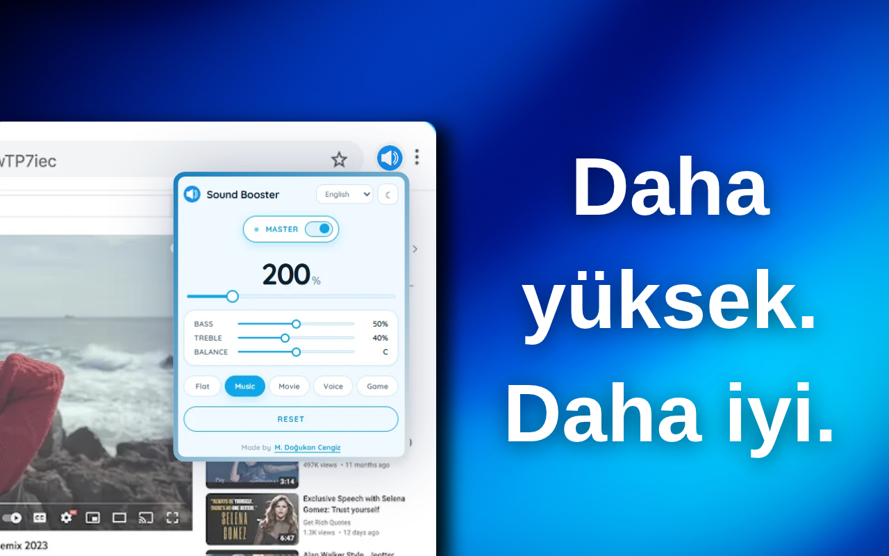

<h1 align="center">Ses Yükseltici (Sound Booster)</h1>

<a href="../README.md">English</a> · <b>Türkçe</b> · <a href="README.es.md">Español</a> · <a href="README.fr.md">Français</a> · <a href="README.pt-BR.md">Português (BR)</a> · <a href="README.ru.md">Русский</a> · <a href="README.hi.md">हिन्दी</a> · <a href="README.zh-CN.md">简体中文</a> · <a href="README.ar.md">العربية</a>

   

       

Tarayıcı sekmelerinin sesini **%1000**'e kadar yükseltin — bas, tiz, denge ve hazır ayarlarla. Ücretsiz ve açık kaynak.

## Özellikler

- 🔊 Herhangi bir sekmede **%1000**'e kadar ses yükseltme
- 🎚️ Bas, tiz ve sol/sağ denge kontrolleri
- 🎛️ Tek tıkla hazır ayarlar: Düz, Müzik, Film, Konuşma, Oyun
- 🛡️ Yüksek seviyede bozulmayı azaltan dahili limiter
- 🌗 Açık ve koyu tema
- 🌍 9 arayüz dili: English, Türkçe, Español, Français, Português, Русский, हिन्दी, 中文, العربية
- 🎵 Çalan sekmeyi gösterir, hızlı sıfırlama düğmesi vardır
- 🆓 Reklam yok, hesap yok, takip yok

## Ekran görüntüleri

  

## Kurulum

### Chrome Web Mağazası'ndan (önerilen)

Tek tıkla kurun: **[Chrome Web Mağazası'nda Ses Yükseltici](https://chromewebstore.google.com/detail/ses-y%C3%BCkseltici/lglddafallgokgookachmcfafhkcobld)**.

### Kaynaktan (geliştirici modu)

1. Bu depoyu indirin veya klonlayın.
2. Chrome'da (veya herhangi bir Chromium tarayıcıda) `chrome://extensions` adresini açın.
3. Sağ üstten **Geliştirici modu**'nu açın.
4. **Paketlenmemiş öğe yükle**'ye tıklayıp `extension/` klasörünü seçin.

## Kullanım

Ses çalan sekmeyi açın, Ses Yükseltici simgesine tıklayın, **Ana Kontrol**'ü açın ve ses kaydırıcısını sürükleyin. Bas, tiz ve dengeyi ayarlayın ya da hazır bir ayar seçin. Ayarlar sekme bazında saklanır.

## Ücretsiz şablon — istediğiniz gibi kullanın

Ses Yükseltici **ücretsiz bir şablondur**. Çatallayabilir (fork), markanıza göre değiştirebilir, kendi sürümünüzü yayınlayabilir ve hatta **Chrome Web Mağazası görsellerini, ekran görüntülerini ve logoyu** ücretsiz, izin almadan kullanabilirsiniz. Bu projeye bağlantı vermeniz hoş olur ama zorunlu değildir.

Kendinize göre uyarlamak için: `extension/_locales/*/messages.json` içindeki adı, `extension/popup.html` ve `extension/popup.js` içindeki yapımcı bağlantısını düzenleyin ve simgeleri değiştirin.

## Destek ve Bağış ❤️

Bu proje ücretsizdir ve ücretsiz kalacaktır. Size yardımcı olduysa geliştirmeye destek olabilirsiniz:

- [Patreon'da destek ol](https://www.patreon.com/cw/dogukancengiz)
- [itch.io](https://dogukancengiz.itch.io/)

Depoya yıldız ⭐ vermek, paylaşmak veya Chrome Web Mağazası'nda yorum bırakmak da çok yardımcı olur!

## Gizlilik ve izinler

Ses, tarayıcınızda Web Audio API ile yerel olarak işlenir. Eklenti hiçbir kişisel veriyi toplamaz, saklamaz veya göndermez; analitik de yoktur. Açılır pencere *Quicksand* yazı tipini Google Fonts'tan yükler.

**Bu izinler neden gerekli?**

- `tabCapture` – sesi yükseltebilmek için mevcut sekmenin sesini yakalar
- `offscreen` – ses işlemeyi ekran dışı bir belgede çalıştırır (Manifest V3)
- `activeTab`, `tabs` – geçerli sekmeyi tanır, başlığını ve simgesini gösterir
- `storage` – ayarlarınızı hatırlar
- `<all_urls>` – eklentinin her sitede çalışmasını sağlar

## Bağlantılar

- [Chrome Web Store](https://chromewebstore.google.com/detail/ses-y%C3%BCkseltici/lglddafallgokgookachmcfafhkcobld)
- [Website](https://www.dogukancengiz.com/)
- [GitHub](https://github.com/dogukan-cengiz)
- [X (Twitter)](https://x.com/mdogukancengiz)
- [Instagram](https://www.instagram.com/mdogukan.cengiz)
- [YouTube](https://www.youtube.com/@dogukan-cengiz)
- [Patreon](https://www.patreon.com/cw/dogukancengiz)
- [Reddit](https://www.reddit.com/user/dogukan_cengiz/)
- [Hugging Face](https://huggingface.co/dogukan-cengiz)
- [itch.io](https://dogukancengiz.itch.io/)

## Lisans

[MIT Lisansı](../LICENSE) ile yayınlanmıştır. © 2026 M. Doğukan Cengiz.
