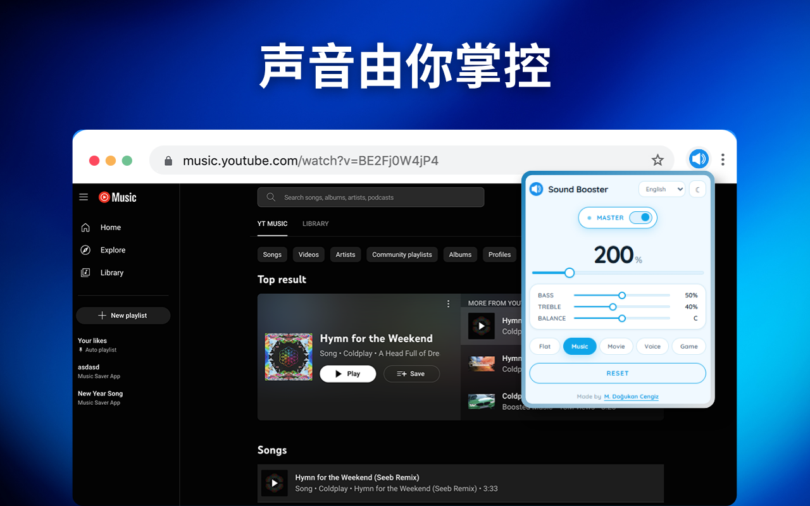
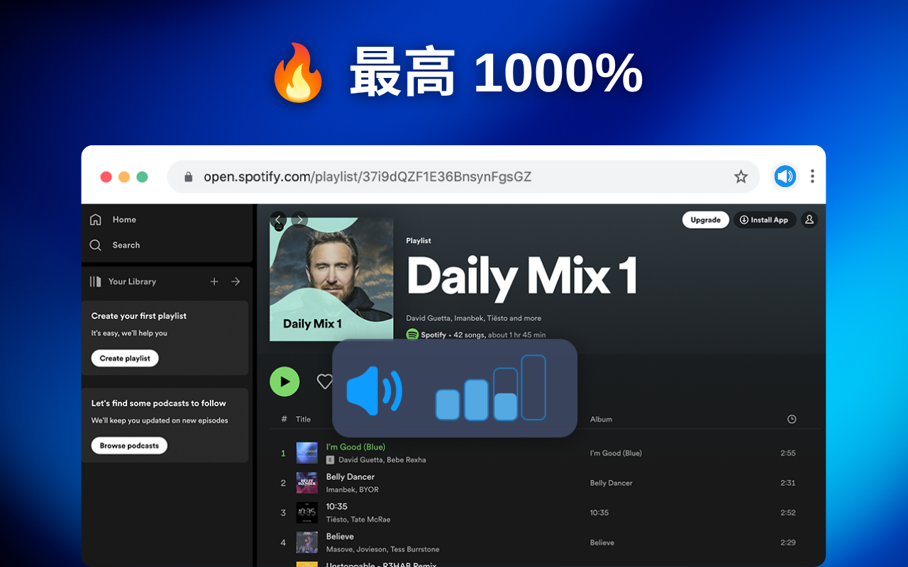
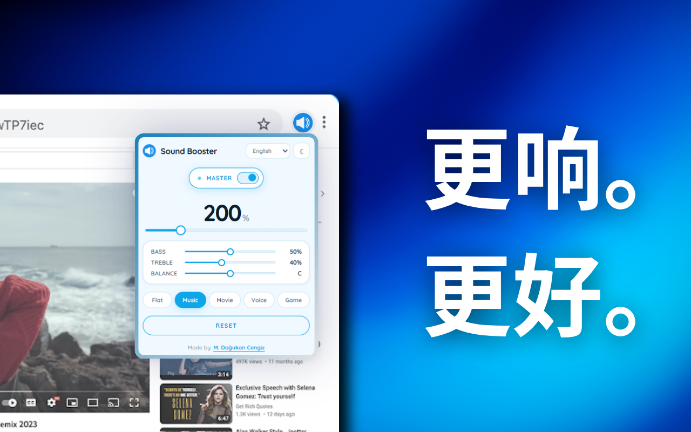

<h1 align="center">声音增强器 (Sound Booster)</h1>

<a href="../README.md">English</a> · <a href="README.tr.md">Türkçe</a> · <a href="README.es.md">Español</a> · <a href="README.fr.md">Français</a> · <a href="README.pt-BR.md">Português (BR)</a> · <a href="README.ru.md">Русский</a> · <a href="README.hi.md">हिन्दी</a> · <b>简体中文</b> · <a href="README.ar.md">العربية</a>

   

       

将浏览器标签页音量提升至 **1000%**，支持低音、高音、平衡和预设。免费且开源。

## 功能特性

- 🔊 任意标签页音量最高可提升 **1000%**
- 🎚️ 低音、高音与左右声道平衡调节
- 🎛️ 一键预设：原声、音乐、电影、人声、游戏
- 🛡️ 内置限幅器，减少高增益时的失真
- 🌗 浅色与深色主题
- 🌍 9 种界面语言：English、Türkçe、Español、Français、Português、Русский、हिन्दी、中文、العربية
- 🎵 显示当前播放的标签页，并提供重置按钮
- 🆓 无广告、无需账号、无追踪

## 截图

  

## 安装

### 通过 Chrome 网上应用店（推荐）

一键安装：**[Chrome 网上应用店中的声音增强器](https://chromewebstore.google.com/detail/ses-y%C3%BCkseltici/lglddafallgokgookachmcfafhkcobld)**。

### 从源码安装（开发者模式）

1. 下载或克隆本仓库。
2. 在 Chrome（或任意 Chromium 浏览器）中打开 `chrome://extensions`。
3. 开启右上角的**开发者模式**。
4. 点击**加载已解压的扩展程序**，选择 `extension/` 文件夹。

## 使用方法

打开正在播放音频的标签页，点击 Sound Booster 图标，打开**主控制**并拖动音量滑块。可调整低音、高音和平衡，或选择预设。设置按标签页分别保存。

## 免费模板：随意使用

Sound Booster 是一个**免费模板**。你可以 Fork、更换品牌、发布自己的版本，甚至免费使用 **Chrome 网上应用店的截图、图片和 Logo**，无需许可。欢迎附上本项目链接，但并非必须。

如需改成自己的：修改 `extension/_locales/*/messages.json` 中的名称、`extension/popup.html` 和 `extension/popup.js` 中的作者链接，并替换图标。

## 支持与捐赠 ❤️

本项目免费，并将一直免费。如果它对你有帮助，欢迎支持后续开发：

- [在 Patreon 上支持](https://www.patreon.com/cw/dogukancengiz)
- [itch.io](https://dogukancengiz.itch.io/)

给仓库点个 Star ⭐、分享给朋友，或在 Chrome 网上应用店留下评价，同样很有帮助！

## 隐私与权限

音频通过 Web Audio API 在浏览器本地处理。扩展不会收集、存储或发送任何个人数据，也没有统计分析。弹出窗口会从 Google Fonts 加载 *Quicksand* 字体。

**为什么需要这些权限？**

- `tabCapture` – 捕获当前标签页的音频以便放大
- `offscreen` – 在离屏文档中运行音频处理（Manifest V3）
- `activeTab`、`tabs` – 识别当前标签页并显示其标题和图标
- `storage` – 记住你的设置
- `<all_urls>` – 让扩展可在任何网站上工作

## 链接

- [Chrome Web Store](https://chromewebstore.google.com/detail/ses-y%C3%BCkseltici/lglddafallgokgookachmcfafhkcobld)
- [Website](https://www.dogukancengiz.com/)
- [GitHub](https://github.com/dogukan-cengiz)
- [X (Twitter)](https://x.com/mdogukancengiz)
- [Instagram](https://www.instagram.com/mdogukan.cengiz)
- [YouTube](https://www.youtube.com/@dogukan-cengiz)
- [Patreon](https://www.patreon.com/cw/dogukancengiz)
- [Reddit](https://www.reddit.com/user/dogukan_cengiz/)
- [Hugging Face](https://huggingface.co/dogukan-cengiz)
- [itch.io](https://dogukancengiz.itch.io/)

## 许可证

基于 [MIT 许可证](../LICENSE) 发布。© 2026 M. Doğukan Cengiz。
